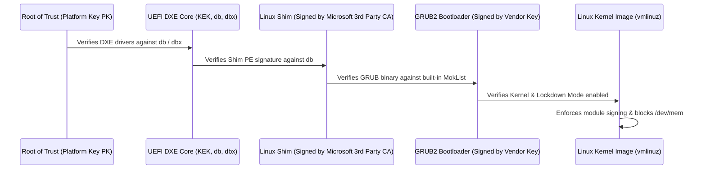

# Firmware Security: UEFI Secure Boot & Measured Boot Architecture

UEFI Secure Boot and Measured Boot establish a cryptographic Chain of Trust starting from physical motherboard hardware ROM, verifying signatures of all pre-OS binaries before execution.

---

## 1. Key Database Hierarchy

* **PK (Platform Key):** Single key owned by OEM/motherboard manufacturer; controls update rights to KEK.
* **KEK (Key Exchange Key):** Authorizes updates to signature database (`db`) and revoked signature database (`dbx`).
* **`db` (Authorized Database):** Contains allowed X.509 certificates and SHA-256 hashes of bootloaders.
* **`dbx` (Forbidden Database):** Revocation list; system halts if any image hash matches an entry in `dbx`.
* **Measured Boot:** Alongside signature checks, every binary is hashed into TPM PCRs 0, 2, and 4 before handoff.
