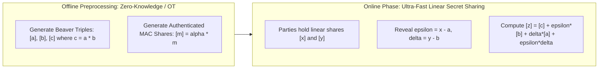

# Cryptography: SPDZ Multi-Party Computation & Beaver Triples

The SPDZ protocol enables $N$ mutually distrusting parties to jointly compute arbitrary arithmetic circuits over a finite field with active security against up to $N - 1$ malicious corruptions using precomputed Beaver multiplication triples.

---

## 1. Beaver Multiplication Steps

To multiply two secret-shared values $[x]$ and $[y]$ using a preprocessed triple $([a], [b], [c])$:
1. Each party locally computes $[\epsilon] = [x] - [a]$ and $[\delta] = [y] - [b]$.
2. All parties broadcast and reconstruct $\epsilon$ and $\delta$ in the clear.
3. Parties compute share of product $[z] = [x \cdot y]$ linearly without further network rounds:

$$[z] = [c] + \epsilon [b] + \delta [a] + \epsilon \delta$$
