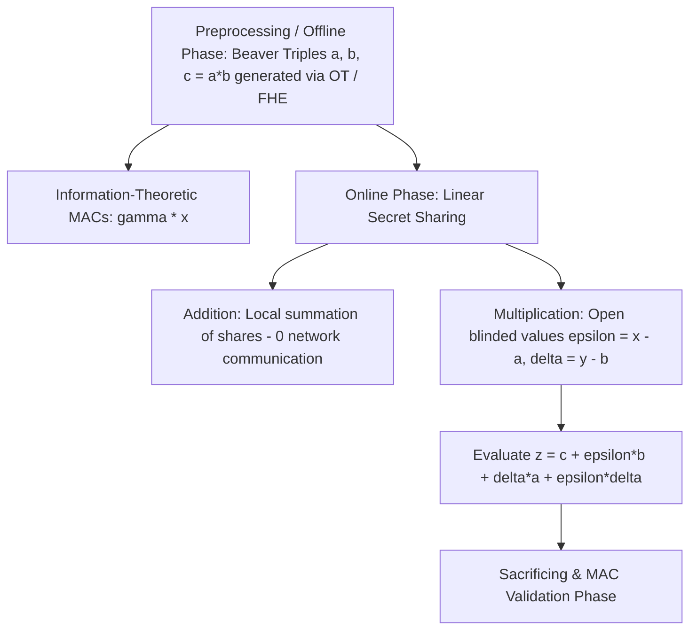

# SPDZ Secure Multi-Party Computation (MPC)

The SPDZ protocol enables $N$ mutually distrusting parties to jointly evaluate an arbitrary arithmetic circuit over finite field $\mathbb{F}_p$ with active (malicious) security with abort against up to $N-1$ corrupt parties.

---

## 1. Information-Theoretic MAC Representation

Every shared value $x$ is stored as:
* Additive secret shares: $\sum_{i=1}^n x_i = x \pmod p$.
* Additive shares of MAC: $\sum_{i=1}^n \gamma_i(x) = lpha \cdot x \pmod p$.
* $lpha = \sum_{i=1}^n lpha_i$ is the global MAC key, never opened during computation.
* Any unauthorized modification to a share fails the final MAC check with probability $1 - 1/p$.

---

## 2. Multiplication via Beaver Triples

Given pre-computed triple shares $[a], [b], [c]$ where $c = a \cdot b$:
1. Parties locally compute and broadcast blinded values:
   $$\epsilon = [x] - [a], \quad \delta = [y] - [b]$$
2. All parties reconstruct public scalars $\epsilon$ and $\delta$.
3. The product share is computed with zero further network round trips:
   $$[z] = [c] + \epsilon [b] + \delta [a] + \epsilon \cdot \delta$$
