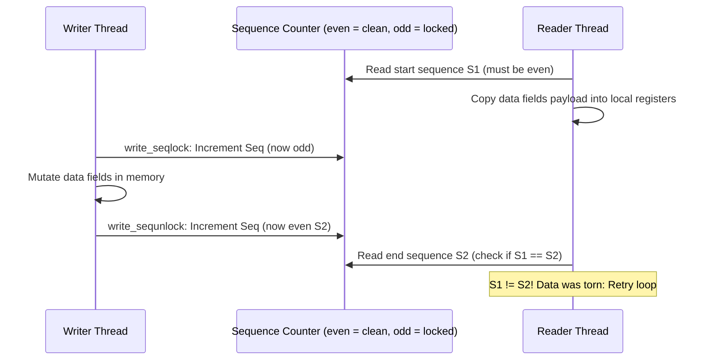

# Sequential Locks (SeqLocks) Reader-Writer Synchronization

SeqLocks provide lock-free, zero-wait read access for small, copyable data structures by using an atomic sequence counter. Readers never block writers, but re-try reads if a sequence parity shift indicates concurrent modification.

---

## 1. Sequence Parity Contract

* **Even Number:** Memory state is consistent and stable for reading.
* **Odd Number:** Writer is currently modifying data; readers must loop or spin until completion.
