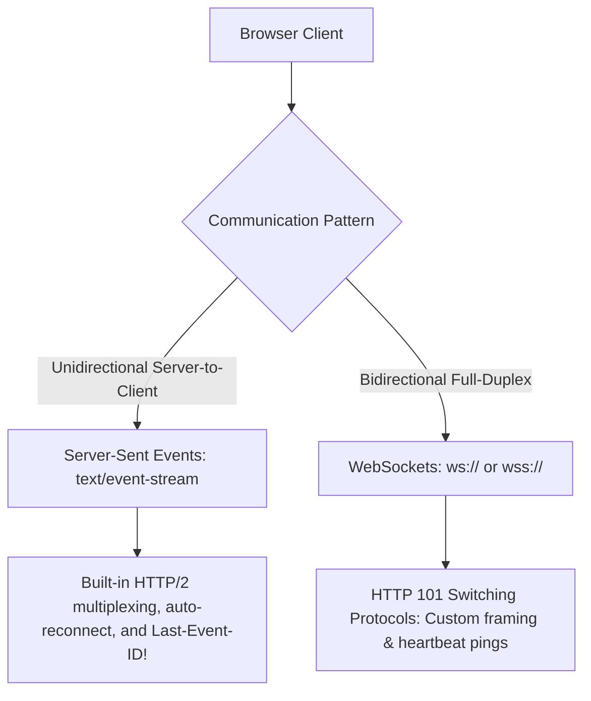

# Real-Time Protocols: Server-Sent Events (SSE) vs WebSockets Architecture

Server-Sent Events (SSE) provides lightweight unidirectional server-to-client streaming over standard HTTP, avoiding WebSocket proxy complexity.

---

## 1. Comparison Matrix

| Feature | Server-Sent Events (SSE) | WebSockets |
| :--- | :--- | :--- |
| **Direction** | Server to Client only | Bidirectional Full-Duplex |
| **Transport** | Standard HTTP/1.1 or HTTP/2 | Upgraded TCP socket |
| **Proxy Compatibility** | Works across all standard firewalls/WAFs | Often blocked by restrictive corporate proxies |
| **Reconnection** | Built-in native browser retry logic | Requires custom reconnect handling |
