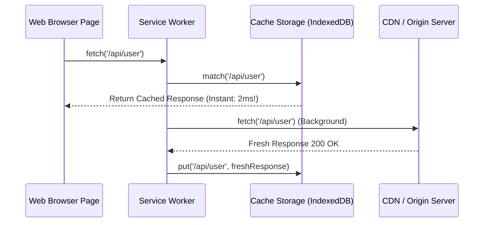

# Progressive Web Apps: Service Worker Cache Storage Strategies

Stale-While-Revalidate responds immediately from Cache Storage while fetching fresh assets in the background to update the cache.

---

## 1. Offline Reliability
Guarantees fast load times on flaky cellular networks while keeping client data eventually consistent.
