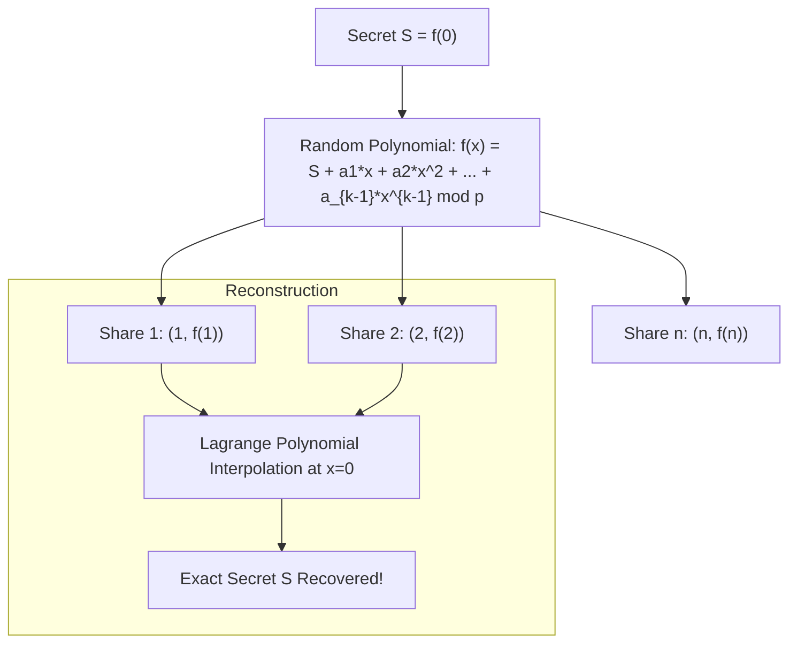

# Cryptographic Key Management: Shamir Secret Sharing (k of n)

Shamir's Secret Sharing splits a secret $S$ into $n$ distinct shares such that any $k$ shares can reconstruct $S$, but $k-1$ shares reveal zero mathematical information.

---

## 1. Information-Theoretic Security
Even with infinite computing power, having $k-1$ points leaves every possible value of $S$ in finite field $\mathbb{F}_p$ equally probable.
