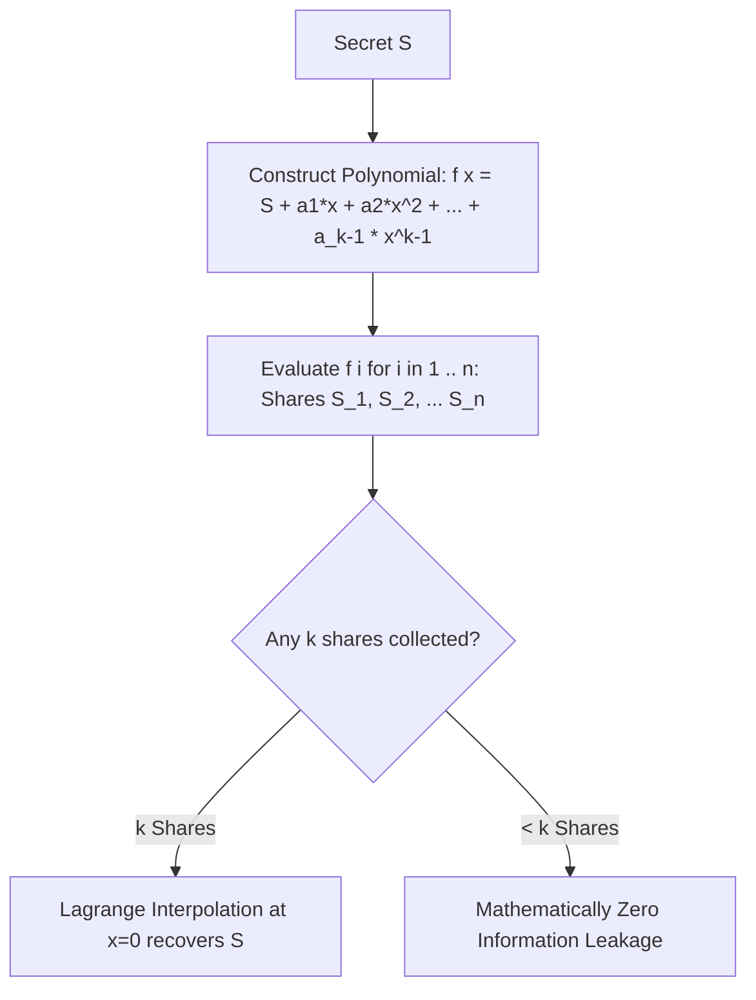

# Shamir Secret Sharing & Lagrange Polynomial Interpolation

Shamir's $(k, n)$-threshold secret sharing scheme encodes a secret $S$ into the constant term $a_0$ of a random degree $k-1$ polynomial over a finite field $\mathbb{F}_p$, ensuring zero information leakage with fewer than $k$ shares.

---

## 1. Lagrange Reconstruction Formula

$$S = f(0) = \sum_{j=1}^{k} y_j \cdot \ell_j(0) \pmod p$$
$$\ell_j(0) = \prod_{m 
e j} rac{0 - x_m}{x_j - x_m} \pmod p$$
