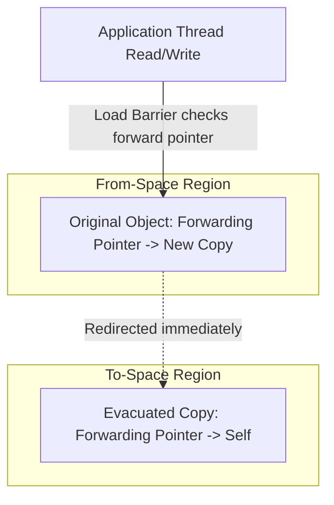

# Shenandoah GC Concurrent Evacuation & Forwarding Pointer Architecture

Shenandoah GC compresses compaction pauses to near-zero by performing heap evacuation concurrently alongside application worker threads using forwarding pointers.

---

## 1. Atomic Evacuation Protocol

1. Allocates target copy in to-space region.
2. Clones object payload.
3. Issues atomic CAS updating original object's forward pointer from `self` to `target`.
4. If CAS wins, evacuation succeeds; if another mutator won, discard target allocation.
