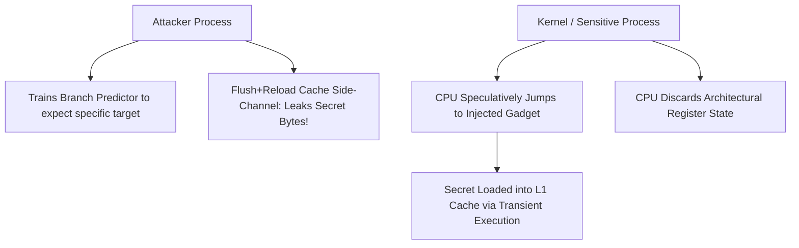

# Hardware Security: Spectre V2 Branch Target Injection and Retpolines

Spectre exploits speculative execution in modern out-of-order CPUs by poisoning the Branch Target Buffer (BTB) to speculatively execute gadget instructions across isolation boundaries.

---

## 1. Retpoline Mitigation
Retpolines replace indirect jumps and calls (`jmp *%rax`) with a Return Trampoline: pushing an address to the stack and executing `ret`, stalling speculative execution until the real target is resolved.
