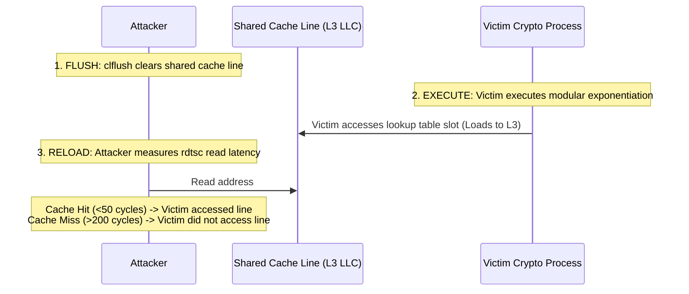

# Microarchitecture: Cache Side-Channel Attacks (Flush+Reload & Prime+Probe)

Cache side-channel attacks measure hardware CPU cache latency differentials to infer memory access patterns and reconstruct encryption keys across process boundaries.

---

## 1. Attack Typologies

| Attack | Shared Memory Required | Target Cache Level | Mechanism |
|---|---|---|---|
| **Flush+Reload** | Yes (Page Deduplication / Shared Lib) | L3 LLC | `clflush` instruction followed by timed `mov` read |
| **Flush+Flush** | Yes | L3 LLC | Measures variable execution timing of `clflush` itself |
| **Prime+Probe** | No (Works in Virtualized Clouds) | L1D / L2 / L3 | Fills cache sets, waits, probes eviction sets |
| **Evict+Time** | No | L1D / LLC | Evicts cache set, triggers victim action, measures total execution time |
