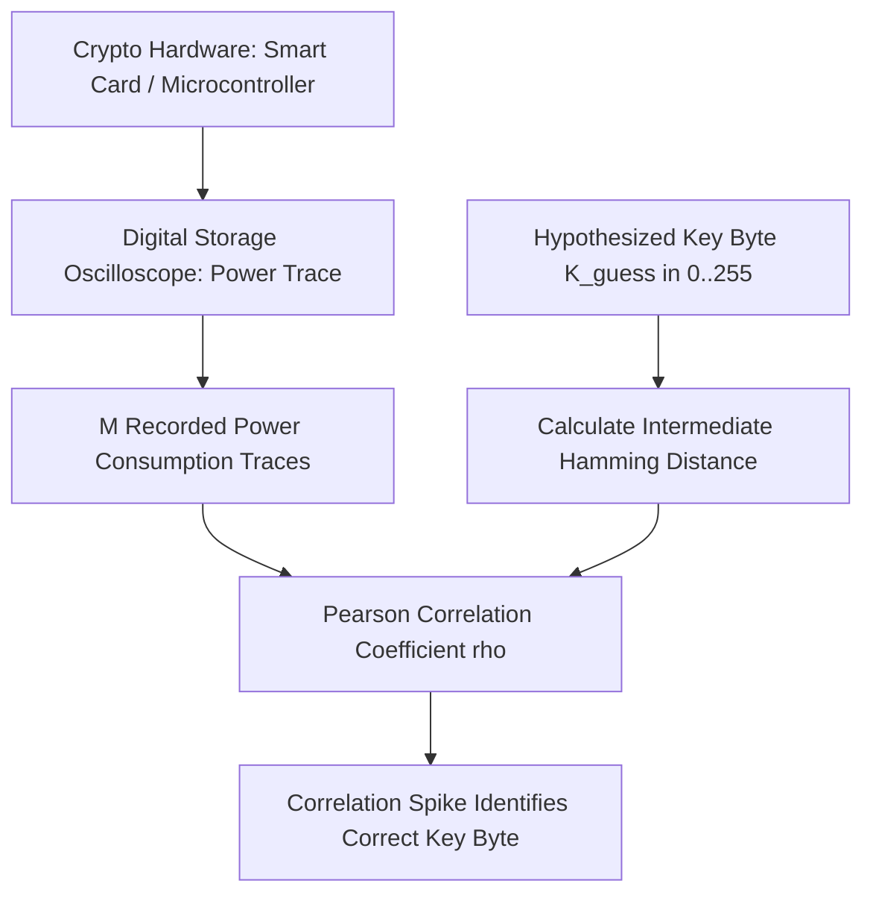

# Hardware Security: Power Analysis Attacks (DPA & CPA)

Differential Power Analysis (DPA) and Correlation Power Analysis (CPA) extract cryptographic keys from hardware devices by statistically correlating power consumption traces with hypothesized intermediate algorithmic state transitions.

---

## 1. Leakage Models & Countermeasures

* **Hamming Weight / Distance Model:** CMOS gates consume power primarily when bit values flip ($0 	o 1$ or $1 	o 0$); power consumption correlates with the Hamming distance $HW(	ext{prev} \oplus 	ext{next})$.
* **Pearson Correlation Metric:**

$$
ho(i, j) = rac{\sum (T_{i, k} - ar{T}_i)(H_{j, k} - ar{H}_j)}{\sqrt{\sum (T_{i, k} - ar{T}_i)^2 \sum (H_{j, k} - ar{H}_j)^2}}$$

* **Hardware Countermeasures:**
  - **Boolean Masking:** Secret states are split across random shares ($x = x_1 \oplus x_2$) such that intermediate values exhibit zero correlation with raw data.
  - **Dual-Rail Precharge Logic:** Circuit topologies that consume identical power regardless of bit transitions.
