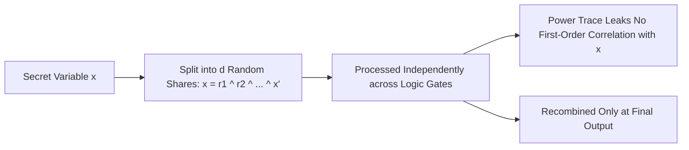

# Differential Power Analysis (DPA) & Masking Schemes

Physical hardware leaks instantaneous power consumption and electromagnetic radiation proportional to the Hamming weight of intermediate cryptographic data registers. Masking breaks this correlation.

---

## 1. Boolean Masking Mechanics

For an order-$d$ masking scheme resilient against $d$-th order DPA attacks:
1. Generate $d$ cryptographic random masks $m_1, m_2, \dots, m_d \in \{0, 1\}^n$.
2. Compute masked value:
   $$x_0 = x \oplus m_1 \oplus m_2 \oplus \dots \oplus m_d$$
3. Linear operations (XOR):
   $$(x \oplus y)_0 = x_0 \oplus y_0, \quad m_{(x \oplus y), i} = m_{x, i} \oplus m_{y, i}$$
4. Non-linear operations (S-Box / AND gates): Require Ishai-Sahai-Wagner (ISW) multiplication gadgets with fresh random masks to prevent glitch-induced leakage.
