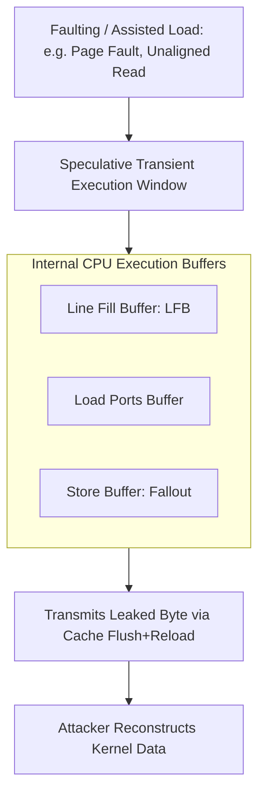

# Microarchitecture: Transient Execution & Microarchitectural Data Sampling (MDS)

Microarchitectural Data Sampling (MDS, including RIDL and Fallout) leaks arbitrary memory contents across hyperthreads and security boundaries by sampling uncore CPU buffer states during speculative execution.

---

## 1. Vulnerability Classes & Hardware Buffers

| Name | CVE | Leaked Hardware Buffer |
|---|---|---|
| **RIDL (MDS-Buffer-Propagate)** | CVE-2018-12127 | Line Fill Buffers (LFB) |
| **Fallout (MSBDS)** | CVE-2018-12126 | Microarchitectural Store Buffers |
| **MLPDS** | CVE-2018-12128 | Microarchitectural Load Ports |
| **TAA (TSX Asynchronous Abort)** | CVE-2019-11135 | TSX Transaction Abort Buffers |

---

## 2. Kernel Defenses

* **`VERW` Instruction Flushing:** Linux kernel executes the `VERW` instruction on every context switch and kernel-to-user return (`syscall exit`), clearing internal CPU buffer contents.
* **SMT Disabling:** Cloud providers disable Simultaneous Multi-Threading (Intel Hyper-Threading) to prevent cross-sibling core sampling.
