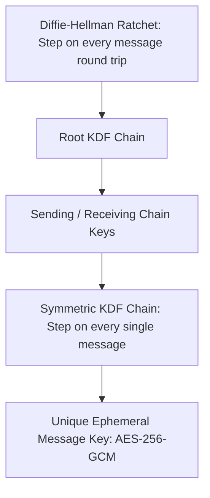

# Signal Double Ratchet: End-to-End Cryptographic Protocol

The Double Ratchet protocol combines a Diffie-Hellman ratchet with two symmetric key-derivation KDF chains, providing both Forward Secrecy and Break-in Recovery (Post-Compromise Security) for asynchronous messaging.

---

## 1. Security Properties

* **Forward Secrecy:** Past messages cannot be decrypted even if current keys are compromised.
* **Break-in Recovery:** An attacker who compromises the current state loses the ability to decrypt future messages as soon as the participants complete an uncompromised DH ratchet step.
