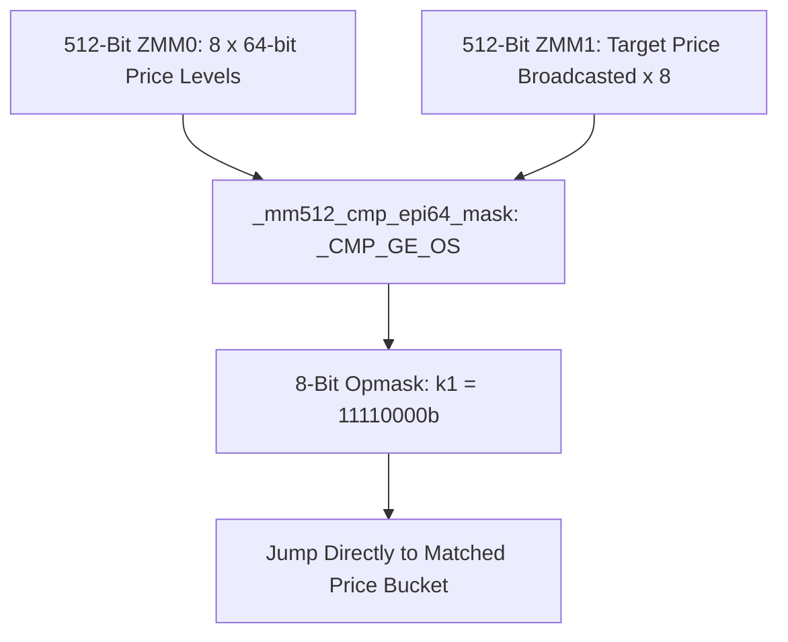

# SIMD AVX-512 Vectorization in Order Book Operations

AVX-512 instructions process 8 64-bit prices or 16 32-bit volumes in parallel within single 512-bit ZMM registers.



---

## 1. Vectorized Price Search with AVX-512

```cpp
#include <immintrin.h>
#include <cstdint>

// Searches 8 contiguous price levels simultaneously in 1 instruction
int find_first_price_level_avx512(const int64_t* prices, int64_t target_price) {
    __m512i target_vec = _mm512_set1_epi64(target_price);
    __m512i prices_vec = _mm512_loadu_si512((const __m512i*)prices);

    // Compare prices >= target_price across all 8 lanes
    __mmask8 mask = _mm512_cmp_epi64_mask(prices_vec, target_vec, _MM_CMPINT_GE);

    if (mask == 0) return -1;
    // Count trailing zeros to find index of first matching price level
    return __builtin_ctz(mask);
}
```
