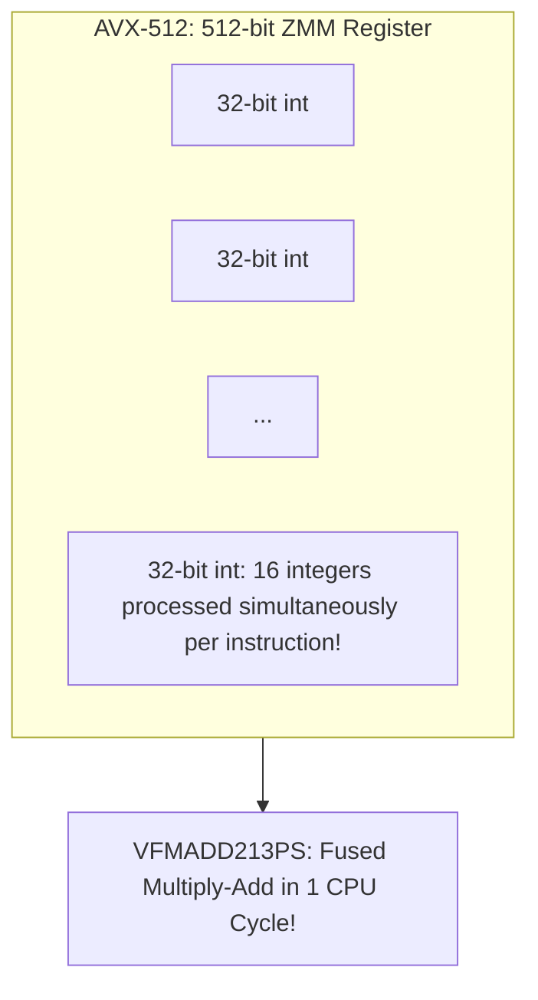

# CPU Microarchitecture: SIMD AVX-512 vs ARM NEON

Single Instruction, Multiple Data (SIMD) vector registers allow a single CPU clock cycle to execute parallel arithmetic across multiple data elements.

---

## 1. Data Alignment Invariant
Unaligned vector memory loads across 64-byte cache line boundaries incur substantial performance penalties. High-performance code enforces 64-byte alignment (`posix_memalign` / `_aligned_malloc`).
