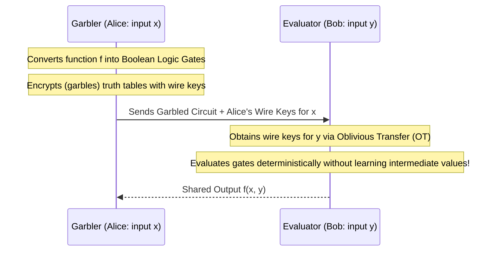

# Secure Multi-Party Computation: Yao Garbled Circuits Protocol

Yao's Garbled Circuits allows two distrusting parties (Alice with input $x$, Bob with input $y$) to compute $f(x, y)$ without revealing their respective private inputs.

---

## 1. Oblivious Transfer Role
1-out-of-2 Oblivious Transfer allows Bob to get keys corresponding to his input bits without Alice learning Bob's bits, and without Bob learning the opposite wire keys.
