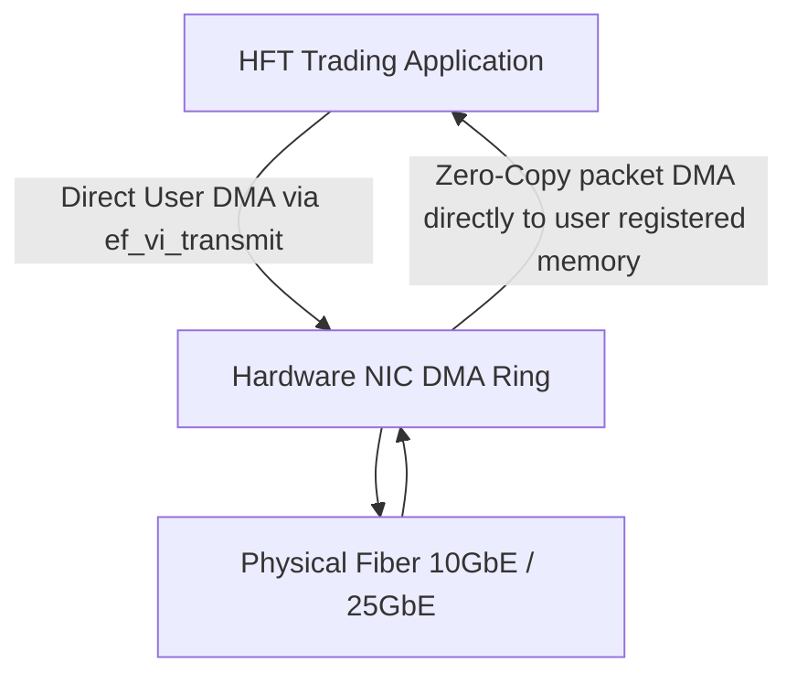

# Solarflare EF_VI: Zero-Copy Kernel Bypass Interface

Solarflare EF_VI provides direct user-space access to the network interface DMA engine, achieving latency under 800 nanoseconds for tick-to-trade financial execution engines.

---

## 1. Memory Registration Protocol

1. Allocate hugepages memory buffer (`mmap` with `MAP_HUGETLB`).
2. Register virtual memory region with hardware NIC using `ef_memreg_alloc()`.
3. Post ring descriptors using lock-free DMA primitives (`ef_vi_receive_post()`).
