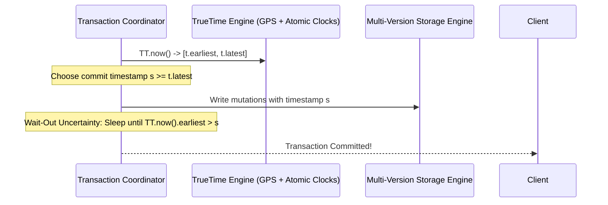

# Google Spanner: TrueTime API and Uncertainty Wait

Google Spanner achieves external consistency (linearizability) across global clusters without communication between read transactions and write transactions by using TrueTime: `TT.now() = [earliest, latest]` with bound `epsilon`.

---

## 1. TrueTime Invariant
For any two transactions $T_1$ and $T_2$, if $T_2$ starts after $T_1$ commits:
$$\text{CommitTime}(T_1) < \text{StartTime}(T_2)$$
Guaranteed by holding the commit response until the current absolute time is guaranteed to have passed the chosen commit timestamp.
