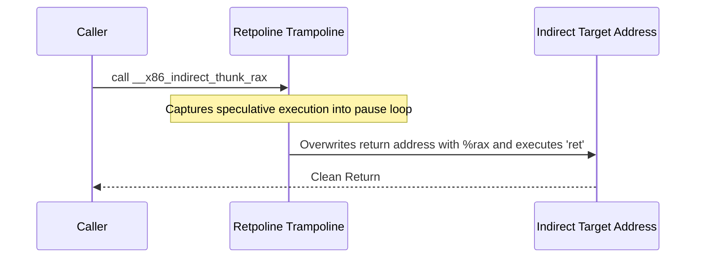

# Speculative Execution: Spectre v2 & Retpoline Trampolines

Spectre v2 (CVE-2017-5715) exploits branch target injection in out-of-order CPUs. The Retpoline (return trampoline) software mitigation isolates indirect branches inside infinite speculation loops.



---

## 1. Assembly Construction

```nasm
__x86_indirect_thunk_rax:
    call    .speculate_trap
.speculate_loop:
    pause
    lfence
    jmp     .speculate_loop
.speculate_trap:
    mov     %rax, (%rsp)    ; Replace return address with destination
    ret                     ; Ret matches RSB, halts speculative BTB injection
```
