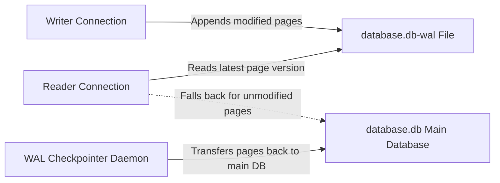

# SQLite Write-Ahead Log (WAL) & Checkpointing Architecture

SQLite WAL mode decouples read transactions from write locks by appending modified database pages to a separate `.wal` file, maintaining readers concurrently without blocking.

---

## 1. Checkpoint Modes

| Checkpoint Mode | Behavior |
|---|---|
| `PASSIVE` | Writes all valid pages without waiting for readers. Does not truncate WAL. |
| `FULL` | Blocks new writers until all readers clear old WAL frames, then transfers all pages. |
| `RESTART` | Like FULL, but waits until all readers exit so WAL log can reset back to frame 1. |
| `TRUNCATE` | Like RESTART, and resets the WAL file length on disk to 0 bytes. |
