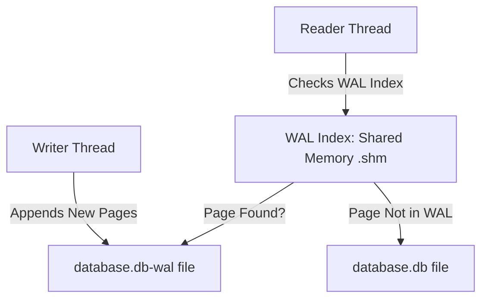

# Embedded Storage: SQLite WAL Mode and Checkpointing

SQLite's WAL mode allows concurrent readers to execute without blocking writers, recording new pages in a separate `-wal` file rather than modifying the main database directly.

---

## 1. Checkpointing Triggers
A checkpoint moves committed pages from the WAL file back into the main database:
- **PASSIVE:** Copies without waiting for readers.
- **FULL:** Waits until all concurrent readers finish, then resets WAL.
- **RESTART:** Like FULL, but guarantees writer starts from offset 0.
