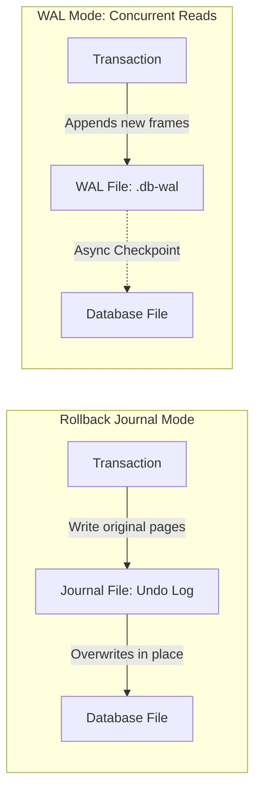

# SQLite: Write-Ahead Logging vs Rollback Journal

SQLite supports two crash-recovery modes: Rollback Journal (modifies database pages directly after creating undo logs) and WAL (appends commits to a separate write log).

---

## 1. Tradeoffs

| Feature | Rollback Journal Mode | WAL Mode (`PRAGMA journal_mode=WAL;`) |
|---|---|---|
| **Concurrency** | Single writer OR multiple readers | Single writer AND multiple readers simultaneously |
| **Write IOPS** | 2 fsync calls per write transaction | 1 fsync call per commit (batchable) |
| **Files on Disk** | `.db` and temporary `-journal` | `.db`, `.db-wal`, and shared-memory `.db-shm` |
| **Network Filesystems**| Compatible | Incompatible: requires shared-memory primitives |
