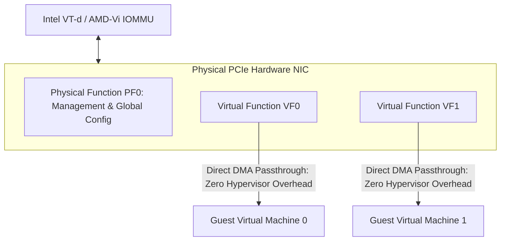

# SR-IOV Virtual Functions & Direct PCIe Passthrough Architecture

Single Root I/O Virtualization (SR-IOV) partitions a physical PCIe network controller (Physical Function, PF) into multiple lightweight virtual PCIe endpoints (Virtual Functions, VF) mapped directly into VM guest address spaces via VT-d IOMMU.

---

## 1. Key Performance Characteristics

* **Line-Rate Virtualization:** Reaches 100GbE line-rate without hypervisor vswitch bridge overhead.
* **IOMMU Protection:** Direct DMA isolated to guest physical memory frames (`guest-physical-address` translation).
