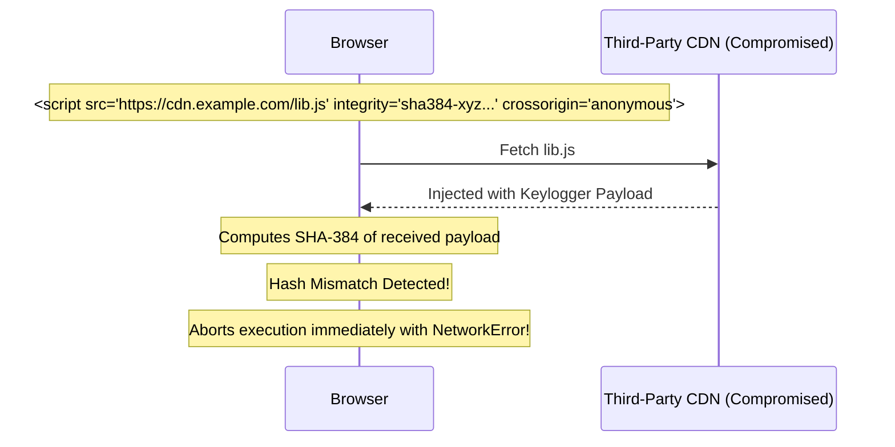

# Supply Chain Security: Subresource Integrity (SRI) Validation

Subresource Integrity guarantees that third-party CDN scripts or stylesheets have not been maliciously tampered with by verifying a cryptographic base64 hash.

---

## 1. CORS Requirement
SRI requires `crossorigin="anonymous"` so that the browser is permitted to read and hash the foreign script bytes before execution.
