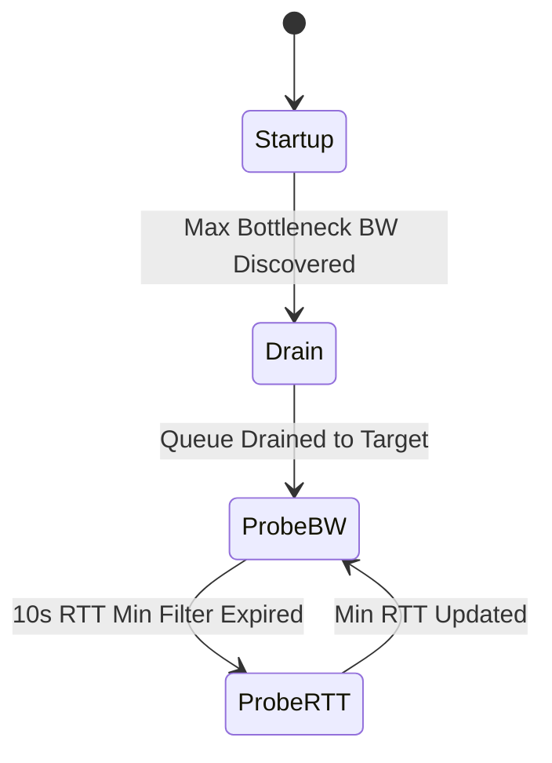

# TCP BBRv3 Model-Based Congestion Control Architecture

BBRv3 (Bottleneck Bandwidth and Round-trip propagation time version 3) estimates physical network channel capacity using explicit feedback rather than packet loss, maximizing throughput while keeping bufferbloat minimal.

---

## 1. Operating States

* **Startup:** Exponential probe ramping transmission rate by $2 / \ln(2) pprox 2.89$ per round trip until bandwidth stops growing.
* **Drain:** Throttles pacing rate below estimated bottleneck capacity to clear queues built up during startup.
* **ProbeBW:** Cyclic pacing adjustment cycling between cruise, refill, and drain phases to track dynamic bandwidth shifts.
* **ProbeRTT:** Temporarily limits inflight packets to 4 segments to measure clean minimum propagation delay.
