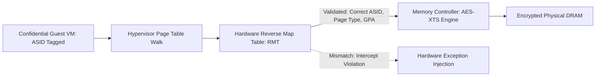

# Confidential Computing: AMD SEV-SNP Architecture

AMD Secure Encrypted Virtualization-Secure Nested Paging (SEV-SNP) protects guest virtual machines from malicious hypervisors by combining AES-128/256 memory encryption with hardware-enforced memory integrity and replay protection.

---

## 1. Core SNP Hardware Mitigations

1. **Reverse Map Table (RMT):** Tracks the ownership of every 4KB physical page. Enforces that only one entity (guest VM, hypervisor, or secure processor) owns each page, preventing hypervisor page re-mapping attacks.
2. **State Protection (SEV-ES):** CPU registers are encrypted and integrity-protected during VM-Exit transitions (`VMSA`), hiding register states from the untrusted hypervisor.
3. **Attestation Report:** The AMD Secure Processor (ASP) signs hardware attestation reports containing VM launch digests, policy bitmasks, and platform TCB versioning.
