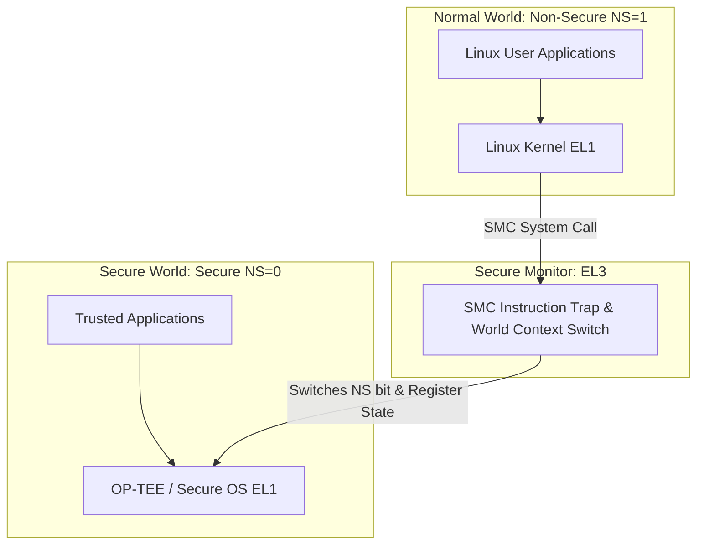

# Trusted Execution: ARM TrustZone & Secure World Partitioning

ARM TrustZone technology hardware-enforces system-wide isolation by partitioning CPU cores, bus fabrics, peripherals, and memory into two execution domains: Normal World (Rich OS / Linux) and Secure World (Trusted OS / OP-TEE).

---

## 1. Hardware Bus & Memory Enforcement

* **Non-Secure (NS) Bit:** Transmitted across the AMBA AXI system bus with every memory read and write transaction; hardware memory controllers block transactions where `NS=1` attempts access to Secure RAM.
* **TZASC (TrustZone Address Space Controller):** Partitions off-chip DRAM into arbitrary Secure and Non-Secure physical memory regions with independent access rules.
* **TZPC (TrustZone Protection Controller):** Configures on-chip peripherals (e.g., hardware crypto engines, secure timers, touch controllers) as either Secure-only or globally accessible.
