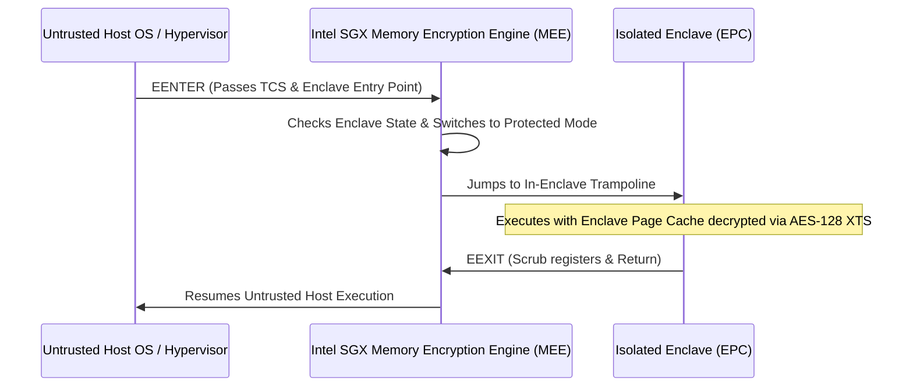

# Trusted Execution: Intel SGX & Enclave Page Cache (EPC)

Intel Software Guard Extensions (SGX) provides hardware-isolated memory regions (Enclaves) that execute protected application code and shield data from compromised host operating systems, hypervisors, and SMM firmware.

---

## 1. Architectural Components

1. **Enclave Page Cache (EPC):** Dedicated physical RAM reserved by BIOS (Processor Reserved Memory - PRM); page contents are transparently encrypted and integrity-verified by the Memory Encryption Engine (MEE).
2. **Measurement Registers:**
   - **`MRENCLAVE`:** SHA-256 digest of enclave code, data, and page permissions computed incrementally during `ECREATE`, `EADD`, and `EEXTEND`.
   - **`MRSIGNER`:** Hash of the authority public key that cryptographically signed the enclave binary.
3. **Attestation:** `EGETKEY` and `EREPORT` instructions produce cryptographically signed hardware reports verifying enclave state to remote relying parties via Intel ECDSA Quote Verification (DCAP).
