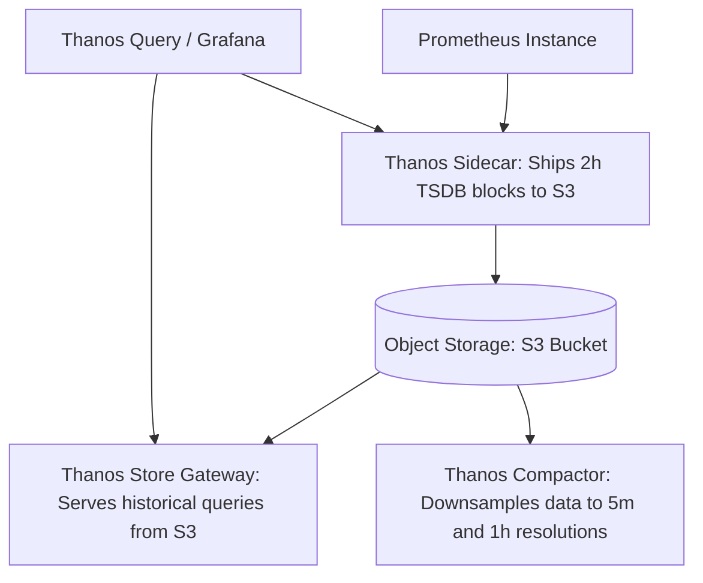

# Long-Term Metric Storage: Thanos Architecture

Thanos scales Prometheus horizontally to multi-year retention across multi-cluster environments using object storage.

---

## 1. Downsampling Optimization
Compactor aggregates historical metrics into 5-minute and 1-hour resolution chunks, allowing multi-year dashboard queries to render in milliseconds.
