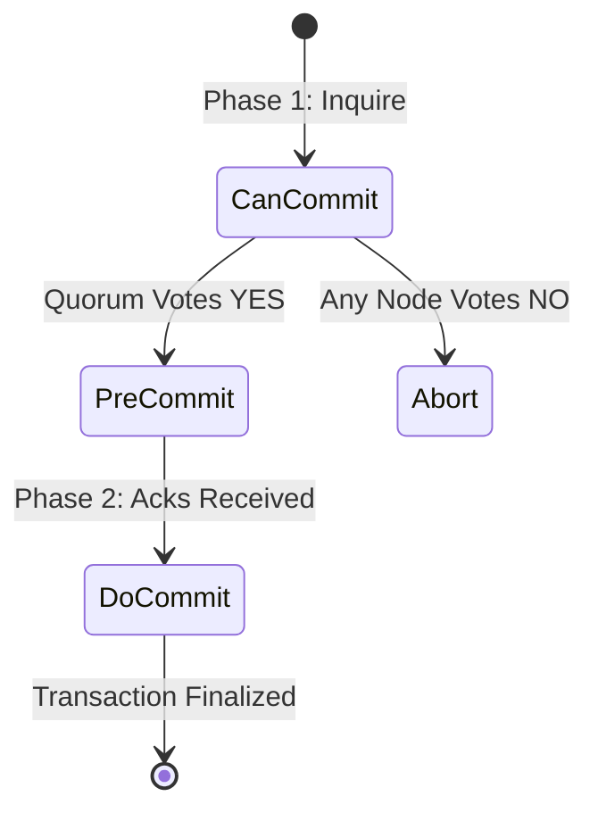

# Distributed Transactions: Three-Phase Commit (3PC)

Three-Phase Commit (3PC) eliminates the blocking nature of 2PC under synchronous network assumptions by splitting the commit phase into `PreCommit` and `Commit`.

---

## 1. Skeen's Non-Blocking Rule
A state protocol is non-blocking if and only if there are no states where:
1. It is possible for some node to be committed while another can still abort.
2. An uncertain state can directly transition to both commit and abort without consensus.
