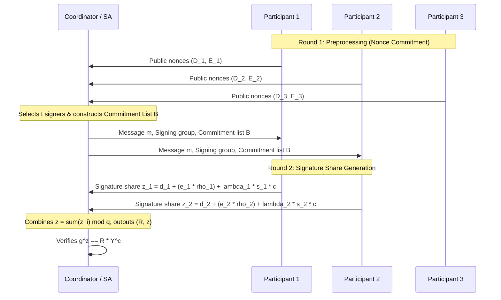

# FROST: Flexible Round-Optimized Schnorr Threshold Signatures

FROST provides $(t, n)$ threshold Schnorr signature generation in 2 network rounds, producing standard single-key Schnorr signatures indistinguishable from non-threshold signatures.

---

## 1. Resistance to Dorking & Wagner Attacks

Earlier threshold Schnorr schemes suffered from sub-exponential forgery attacks (Wagner's generalized birthday problem) during concurrent signing sessions.

FROST prevents this through **binding factors** $
ho_i$:
1. Each participant commits to two nonces: $(d_{i,1}, e_{i,1})$ yielding public commitments $(D_{i,1}, E_{i,1})$.
2. The coordinator aggregates all nonces into commitment list $B = \{(i, D_i, E_i)\}_{i \in S}$.
3. Each participant deterministically computes binding factor:
   $$
ho_i = H_1(i, m, B)$$
4. The composite group commitment becomes:
   $$R = \sum_{i \in S} \left( D_i + 
ho_i E_i 
ight)$$
5. Binds each participant's nonce linearly to the exact set of co-signers and message, neutralizing concurrency attacks.
