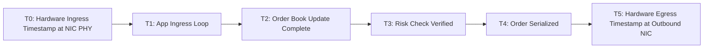

# Tick-to-Trade Profiling & Latency Instrumentation

Tick-to-trade latency measures elapsed time from the arrival of the last bit of a market data packet at the NIC to the first bit of the matching order hitting the wire.



---

## 1. Latency Measurement Stages

$$\text{Latency}_{\text{Internal}} = T4 - T1$$
$$\text{Latency}_{\text{Hardware Tick-to-Trade}} = T5 - T0$$

---

## 2. High-Precision Circular Latency Histogram

```cpp
#include <array>
#include <atomic>
#include <cstdint>

class LatencyHistogram {
public:
    static constexpr size_t MAX_BUCKETS = 10000; // 0 to 9,999 nanoseconds
    
    void record(uint64_t elapsed_nanos) {
        if (elapsed_nanos >= MAX_BUCKETS) {
            overflow_count_++;
        } else {
            buckets_[elapsed_nanos]++;
        }
    }

    uint64_t percentile(double p) const {
        uint64_t total = overflow_count_;
        for (auto count : buckets_) total += count;

        uint64_t threshold = total * p;
        uint64_t running = 0;
        for (size_t i = 0; i < MAX_BUCKETS; ++i) {
            running += buckets_[i];
            if (running >= threshold) return i;
        }
        return MAX_BUCKETS;
    }

private:
    std::array<uint32_t, MAX_BUCKETS> buckets_{};
    uint64_t overflow_count_ = 0;
};
```
