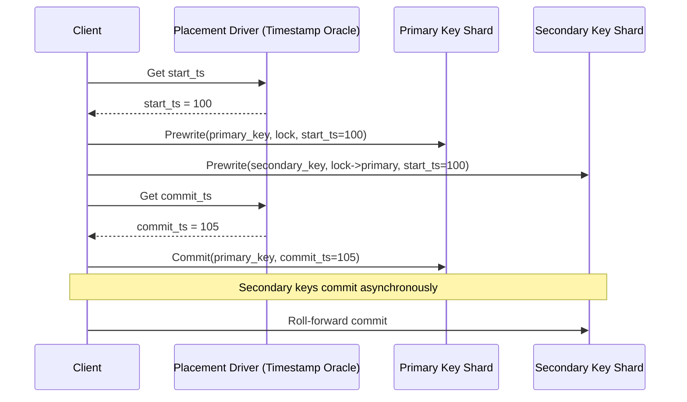

# TiKV: Percolator Distributed Transaction Model

TiKV implements ACID snapshot isolation across distributed key-value storage nodes using Google's Percolator two-phase commit protocol, coordinated by a Placement Driver (PD).

---

## 1. Three Column Families

* **`data` CF:** Stores actual row values indexed by key and commit timestamp `(key, commit_ts)`.
* **`lock` CF:** Holds uncommitted locks pointing to the primary key lock `(key, start_ts)`.
* **`write` CF:** Records committed metadata `(key, commit_ts) -> start_ts` for MVCC reads.
