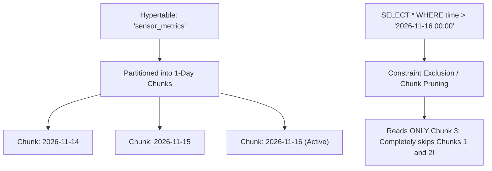

# Time-Series Architecture: TimescaleDB Hypertables & Chunk Pruning

TimescaleDB partitions PostgreSQL tables across time dimensions into small, manageable standard tables called **Chunks**.

---

## 1. Memory Residency Advantage
Each active chunk's B-Tree indexes easily fit within the PostgreSQL `shared_buffers` cache, preventing random disk page evictions during high-throughput ingestion.
