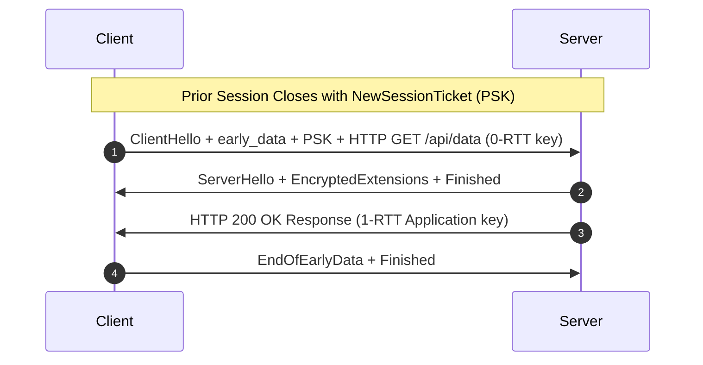

# TLS 1.3 0-RTT Early Data Resumption (RFC 8446)

TLS 1.3 reduces standard handshake latency from two round-trips to one round-trip (1-RTT), and allows zero round-trip (0-RTT) resumption for returning clients.

---

## 1. Key Derivation

$$	ext{Early Secret} = 	ext{HKDF-Extract}(0, 	ext{PSK})$$
$$	ext{Client Early Traffic Secret} = 	ext{HKDF-Expand-Label}(	ext{Early Secret}, 	ext{"c e traffic"}, 	ext{ClientHello Hash}, 	ext{Hash.length})$$

---

## 2. Replay Protections

- Single-use session tickets tracked in distributed memory cache.
- Client hello recording via in-memory sliding window filter.
- Application restriction: only idempotent requests (`GET`, `HEAD`) permitted over 0-RTT.
