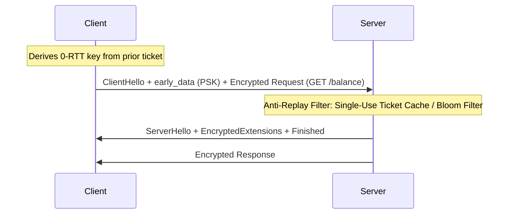

# TLS 1.3: 0-RTT Early Data & Anti-Replay Architecture

TLS 1.3 allows clients to transmit application data in the first flight of packets (0-RTT) using Pre-Shared Keys (PSK) derived from prior sessions, requiring anti-replay protections.

---

## 1. Replay Attacks & Mitigations

1. **Replay Vulnerability:** An eavesdropping attacker can intercept and re-transmit the 0-RTT flight, causing non-idempotent HTTP actions (e.g., `POST /pay`) to duplicate.
2. **Idempotency Rule:** RFC 8446 mandates that 0-RTT early data must only be allowed for idempotent HTTP methods (`GET`, `HEAD`).
3. **Server Cache Schemes:** Servers enforce freshness by validating ClientHello timestamps within an allowed window ($\Delta t pprox 10	ext{s}$) and recording ticket identifiers in distributed bloom filters.
