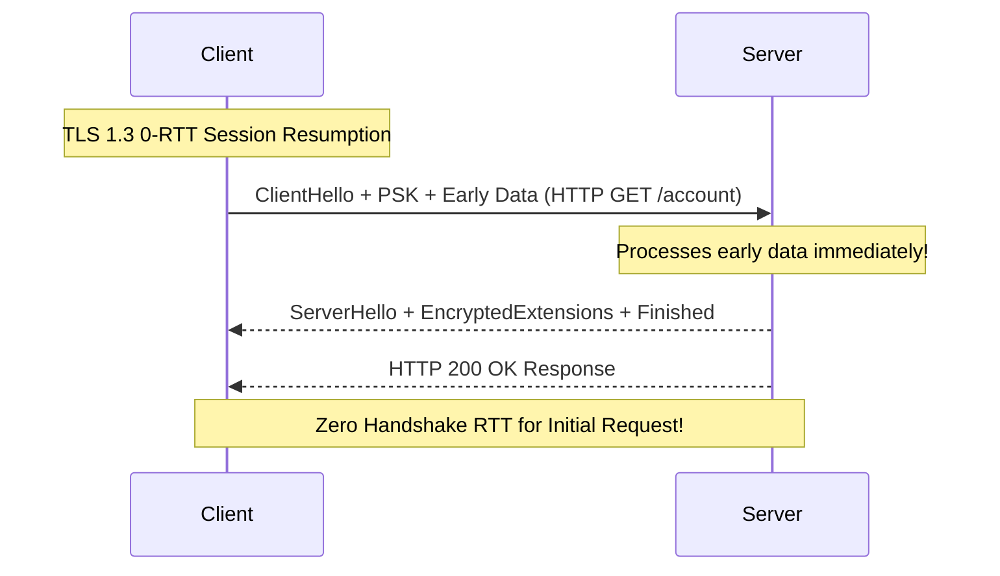

# Transport Security: TLS 1.3 0-RTT Early Data and Replay Attacks

TLS 1.3 allows clients with pre-shared keys (PSK) from previous sessions to transmit application payloads in the first flight (`0-RTT`), eliminating handshake round-trips.

---

## 1. The Replay Vulnerability & Defenses
Because early data is sent before server confirmation, an on-path attacker can record and replay the packet.
- **Rule:** Never allow non-idempotent operations (POST /payment) over 0-RTT.
- **Server Defense:** Single-use ticket tracking and strict ClientHello arrival time windows.
