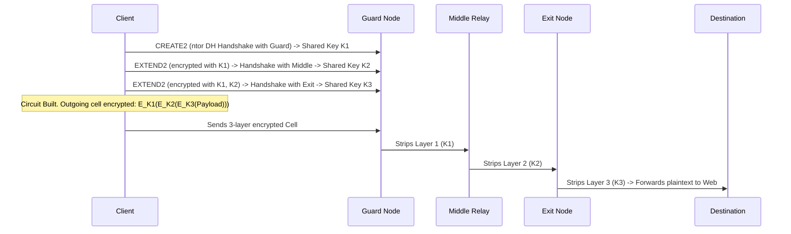

# Tor Onion Routing: Telescopic Circuit Cryptography Architecture

Tor routes traffic through a three-hop relay circuit (Guard, Middle, Exit), wrapping application packets in multiple concentric layers of AES/ChaCha20 encryption using Diffie-Hellman key exchanges.

---

## 1. Forward Secrecy & Cell Sizing

All relay payloads are packed into fixed 514-byte cells (`RelayCell`), preventing traffic analysis and timing correlation attacks across intermediate routing hops.
