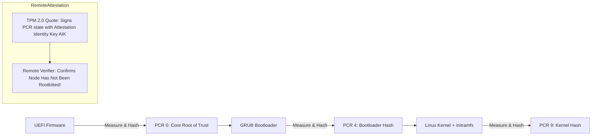

# Platform Security: TPM 2.0 Measured Boot and PCR Architecture

Trusted Platform Module (TPM 2.0) measures cryptographic hashes of system firmware, bootloader, kernel, and initial ramdisk into Platform Configuration Registers (PCRs).

---

## 1. PCR Extend Operation
PCR registers cannot be overwritten arbitrarily; they can only be **extended**:
$$\text{PCR}_{new} = \text{SHA256}(\text{PCR}_{old} \parallel \text{Measurement})$$
Ensures an attacker cannot erase traces of malicious boot stages without resetting hardware.
