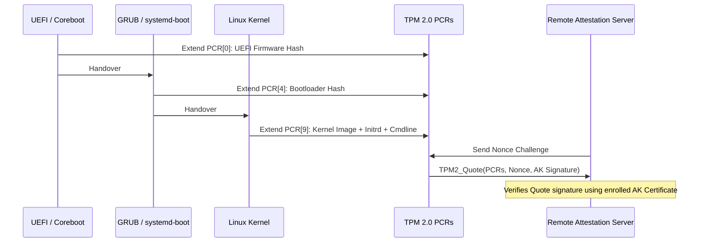

# TPM 2.0 Measured Boot & Remote Attestation

Trusted Platform Modules (TPM 2.0) establish a hardware-rooted chain of trust by recording cryptographic hash measurements into Platform Configuration Registers (PCRs).

---

## 1. PCR Extend Operation Invariant

PCRs cannot be written directly to arbitrary values; they can only be **extended**:

$$	ext{PCR}_{	ext{new}} = 	ext{Hash}\left(	ext{PCR}_{	ext{old}} \parallel 	ext{Measurement}
ight)$$

This mathematical one-way accumulation ensures an attacker cannot erase evidence of booting an untrusted intermediate component without resetting the entire chip.
