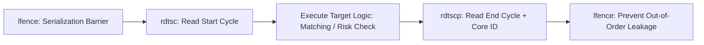

# Invariant TSC & Sub-Nanosecond Benchmarking

The Time Stamp Counter (TSC) on modern x86 processors increments at a fixed frequency across all power states, enabling sub-nanosecond latency profiling.



---

## 1. Instruction Serialization

`rdtsc` is not a serializing instruction on x86; out-of-order execution cores can execute operations before or after the timer read. Proper benchmarking requires `lfence`:

```cpp
#include <x86intrin.h>
#include <cstdint>

static inline uint64_t rdtsc_start() {
    _mm_lfence();
    uint64_t cycles = __rdtsc();
    _mm_lfence();
    return cycles;
}

static inline uint64_t rdtsc_end() {
    unsigned int aux;
    uint64_t cycles = __rdtscp(&aux);
    _mm_lfence();
    return cycles;
}
```

---

## 2. Converting Cycles to Nanoseconds

$$\text{Latency}_{\text{ns}} = \frac{(\text{EndCycles} - \text{StartCycles}) \times 10^9}{\text{TSC Frequency (Hz)}}$$

TSC frequency is constant and independent of dynamic turbo-boost clock scaling on modern processors with the `constant_tsc` and `nonstop_tsc` CPU flags.
