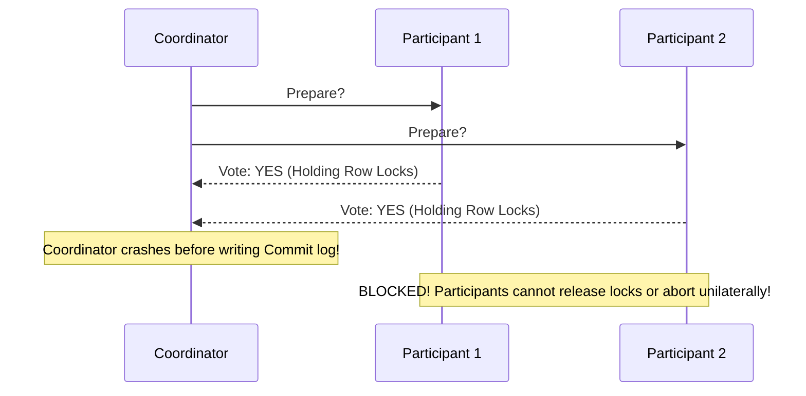

# Distributed Transactions: Two-Phase Commit Coordinator Failure

Two-Phase Commit (2PC) guarantees atomic commitment across distributed participants but suffers from synchronous blocking when the coordinator crashes during Phase 2.

---

## 1. The Uncertainty Period
Once a participant votes `YES`, it enters the uncertain state:
- It cannot abort unilaterally because the coordinator might have decided to commit.
- It cannot commit unilaterally because another participant might have voted `NO`.
