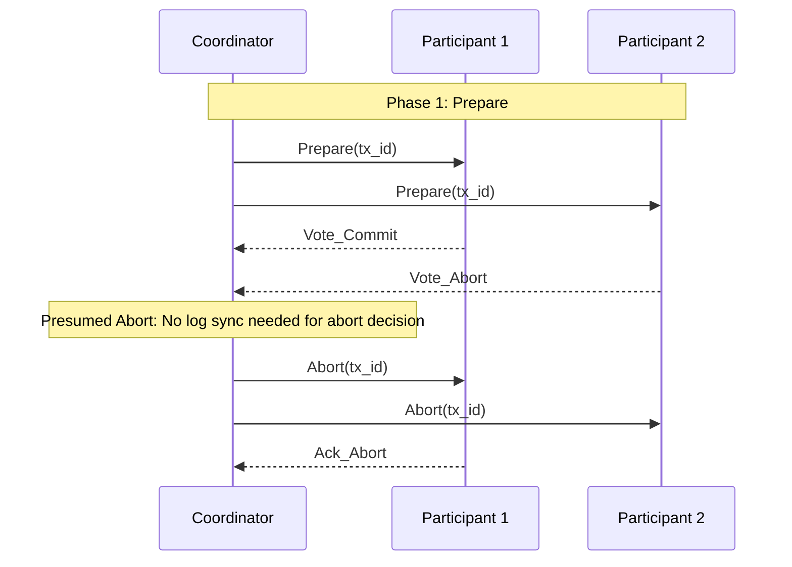

# Two-Phase Commit (2PC): Presumed Abort Optimization

Two-Phase Commit guarantees atomic transactions across independent database shards. The Presumed Abort optimization eliminates log flush latency for aborted distributed transactions.

---

## 1. Presumed Abort Mechanics

1. **Information Asymmetry:** The coordinator assumes any unknown transaction aborted without writing an explicit abort record to durable WAL.
2. **Cost Reduction:** If any participant votes abort or fails to respond within timeout, the coordinator discards transaction state from memory without issuing an `fsync`.
3. **Commit Barrier:** A commit decision still requires synchronous log flush on the coordinator before issuing commit messages to participants.
