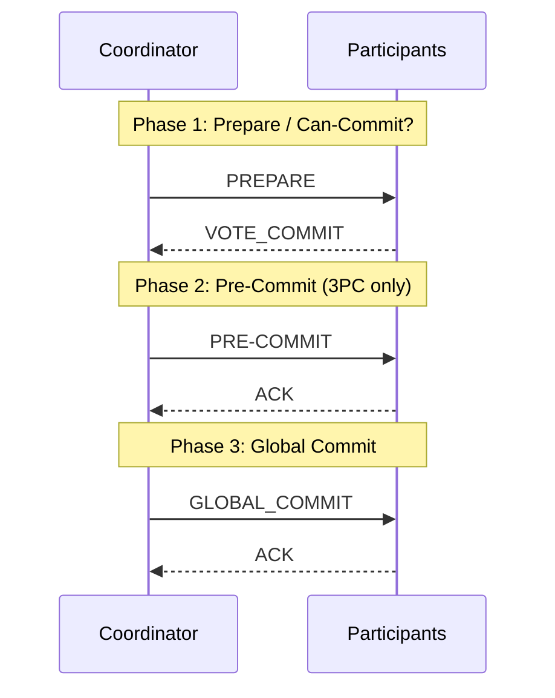

# Two-Phase (2PC) vs Three-Phase Commit (3PC) Protocols

Distributed atomic commit protocols coordinate multi-node transaction finality. 2PC guarantees atomicity but blocks on coordinator failure, whereas 3PC introduces pre-commit states to eliminate indefinite blocking during clean partitions.

---

## 1. Protocol Comparison

| Feature | Two-Phase Commit (2PC) | Three-Phase Commit (3PC) |
|---|---|---|
| **Blocking Behavior** | Blocking (indefinite if coordinator dies in prepared state). | Non-blocking under clean node crash failures. |
| **Network Message Rounds** | 2 Rounds (Prepare + Commit). | 3 Rounds (Can-Commit + Pre-Commit + Commit). |
| **Partition Vulnerability** | Safe against split-brain, blocks execution. | Vulnerable to inconsistent decisions during split-brain partitions. |
