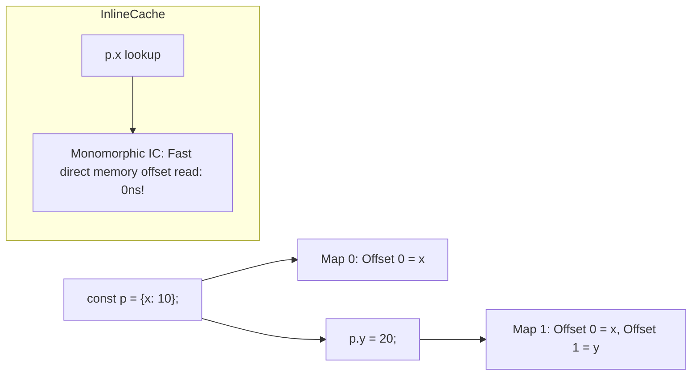

# V8 Internals: Hidden Classes (Maps) and Inline Caches (IC)

V8 achieves near-C++ object property access speeds in dynamic JavaScript by dynamically synthesizing hidden classes (Maps) and caching property offsets.

---

## 1. Megamorphic Degradation
When a single call site receives objects with more than 4 distinct hidden class shapes, the inline cache degrades to **Megamorphic**, falling back to hash table lookups.
