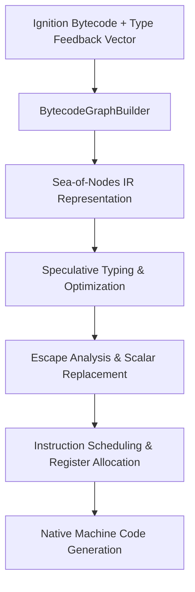

# V8 TurboFan Sea-of-Nodes Speculative Optimization

V8 TurboFan represents JavaScript execution as a unified graph combining data flow, control flow, and side-effect chains without rigid basic block boundaries, enabling aggressive global value numbering and dead code elimination.

---

## 1. Edge Categories in Sea-of-Nodes

* **Value Edges:** Carry computational data results between operator nodes.
* **Effect Edges:** Track sequencing of stateful operations (memory writes, object mutations).
* **Control Edges:** Direct branches, conditional splits, and merge points.
