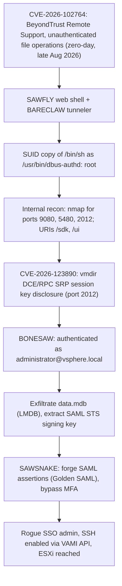

# Virtualization Security: vCenter SRP Session Key Disclosure & the BeyondTrust Pivot (CVE-2026-123890, CVE-2026-102764)

A suspected PRC-nexus espionage actor, **ARMORY CASTLE** (formerly UNC5221), chained two zero-days: **BeyondTrust Remote Support CVE-2026-102764** for initial access and **VMware vCenter CVE-2026-123890** to take over the virtualization control plane. Both are in the CISA KEV catalog (BeyondTrust on 2026-10-16, vCenter on 2026-11-20).

---

## 1. Intrusion Path

---

## 2. The vCenter Flaw (CVE-2026-123890, CVSS 9.8)

| Aspect | Detail |
| :--- | :--- |
| Component | VMware Directory Service (`vmdir`), DCE/RPC interface |
| Class | Unauthenticated Secure Remote Password (SRP-6a) session key disclosure |
| Reported root cause | Predictable UUIDv1 timestamp generation in the SRP authentication interface, which lets the session key be compromised without knowing a password |
| Result | Authenticated session as `administrator@vsphere.local` |
| Reachability | Network access to the RPC service (port 2012 in observed activity) |
| Workarounds | None. Patch only (VMSA-2026-0009) |

Distinct from **CVE-2026-59309** (LDAP-based `vmdir` bypass on ports 389/636, disclosed 2026-07-29). Mandiant reports the exploit tool was used against a vCenter already patched for CVE-2026-59309, and that its build timestamp predates that disclosure.

---

## 3. Post-Exploitation Impact on a vCenter

| Capability | Why it matters |
| :--- | :--- |
| Read `data.mdb` (LMDB directory database) | Contains identity material |
| Steal STS SAML signing key | Attacker can mint valid administrator tokens |
| Golden SAML forgery | Bypasses MFA, impersonates any user |
| Create SSO admin / local admin accounts | Persistence that survives password resets |
| Enable SSH through VAMI REST API | Direct shell on the appliance |
| Control over ESXi hosts | Access to every guest VM and its data |

---

## 4. Fixed Versions (VMSA-2026-0009)

| Product | Fixed version |
| :--- | :--- |
| vCenter 9.1.x | 9.1.1.0200 |
| vCenter 9.0.x | 9.0.2.0200 |
| vCenter 8.0 | 8.0 U3m |
| vCenter 7.0 | Contact Broadcom (extended support only) |
| VMware Cloud Foundation 5.x | 5.2.5 (KB88287) |
| Telco Cloud Platform / Infrastructure | KB463116 |

BeyondTrust CVE-2026-102764 affects Remote Support up to 26.2.3. Apply patch **BT26-05-RS**. Versions older than 24.3.1 must upgrade first. SaaS tenants were patched on 2026-10-09.

---

## 5. Defensive Checklist

* **Patch vCenter and BeyondTrust** as above. Patching does not remove an existing foothold.
* **Isolate management networks.** vCenter RPC (2012), VAMI (5480) and LDAP (389/636) should be reachable only from a dedicated admin segment.
* **Assume key theft if exposed.** If a vulnerable vCenter was reachable by an attacker, rotate the STS signing certificate and treat all SSO accounts and tokens as suspect.
* **Audit identity objects:** unknown SSO administrators (for example names beginning `sps-`), new machine accounts in `vmdir`, new Global Administrator permissions on the root folder.
* **Check SSH state** on vCenter and look for VAMI `PUT /rest/appliance/access/ssh` calls.
* **Remote-support appliances** hold every credential they broker: if compromised, rebuild from a known-good state, rotate all stored credentials, revoke sessions, review new MFA registrations on privileged accounts.
* **Hunt for SUID abuse:** unexpected SUID binaries such as `/usr/bin/dbus-authd`.
* **Preserve logs off-box.** The actor routinely deleted appliance logs.

---

## 6. Design Lessons

| Lesson | Practice |
| :--- | :--- |
| Privileged-access tools are crown-jewel targets | Minimise exposure, segment, monitor like domain controllers |
| Predictable identifiers are not secrets | Use CSPRNG-generated values for anything feeding authentication |
| Token-signing keys are the real root of trust | Protect and rotate; alert on export |
| Disclosure of one auth bug does not mean the class is closed | Related flaws in the same service (CVE-2026-59309 vs CVE-2026-123890) can persist |

---

## References

* Broadcom VMSA-2026-0009
* Google Threat Intelligence Group, "ARMORY CASTLE Exploits vSphere" (2026-11-19) and "ARMORY CASTLE Exploits BeyondTrust" (2026-10-15)
* BeyondTrust advisory BT26-05; CISA alert of 2026-10-16
* CISA KEV additions, 2026-11-20
