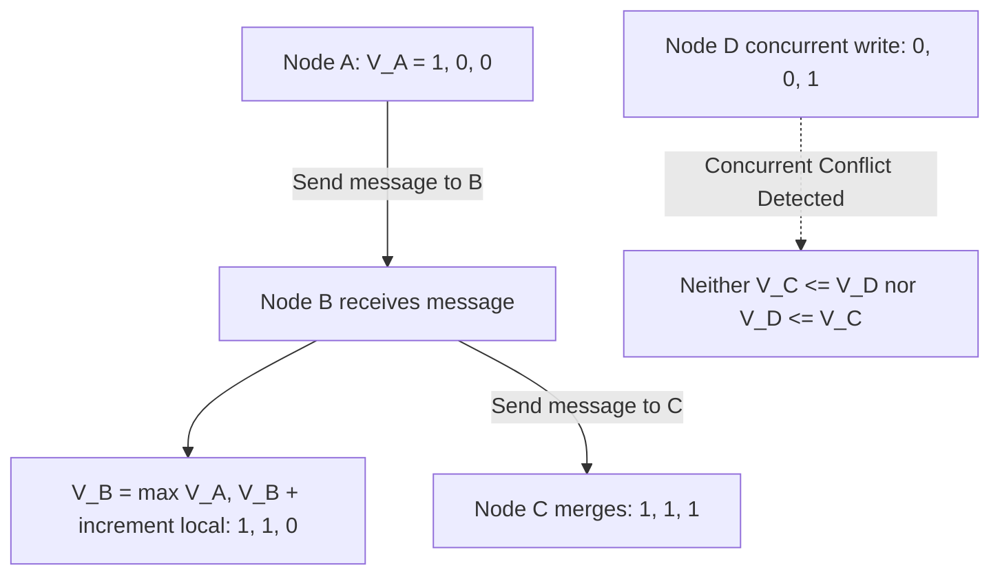

# Vector Clocks & Causal Dependency Tracking Architecture

Vector clocks determine partial ordering and detect concurrent conflicts in distributed systems without synchronized physical wall clocks.

---

## 1. Causality Comparison Rule

For vector clocks $V_1$ and $V_2$:
$$V_1 \le V_2 \iff orall k.\ V_1[k] \le V_2[k]$$
$$V_1 < V_2 \iff (V_1 \le V_2) \land (\exists k.\ V_1[k] < V_2[k])$$
If neither $V_1 \le V_2$ nor $V_2 \le V_1$, the operations are **concurrent** ($V_1 \parallel V_2$) and require resolution.
